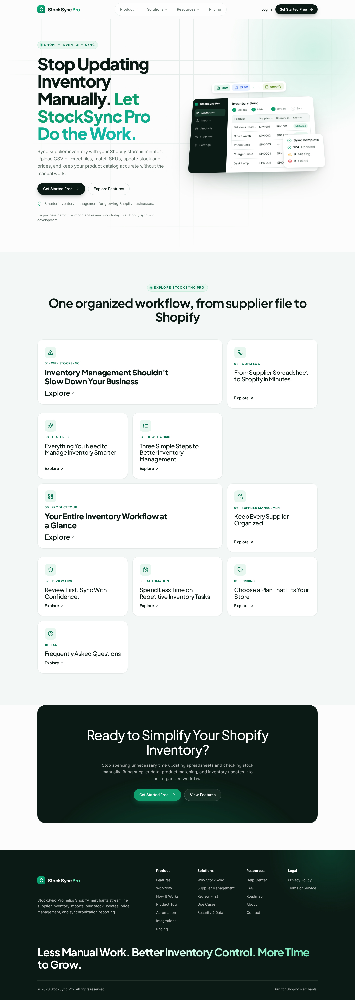
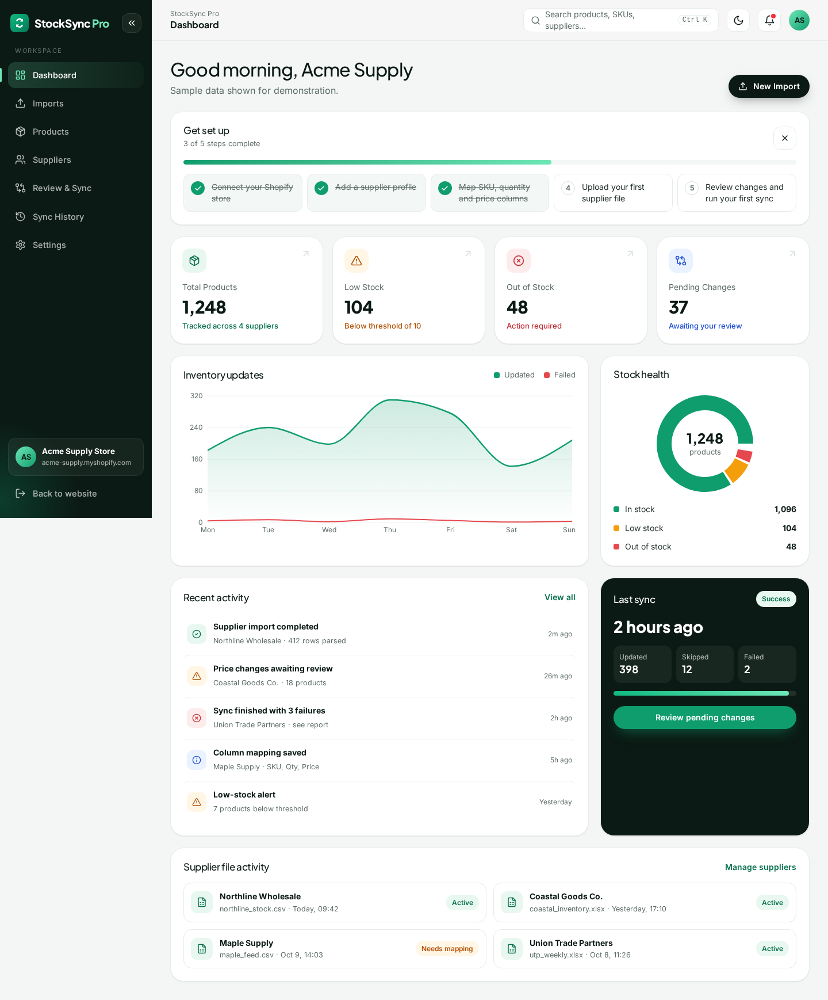
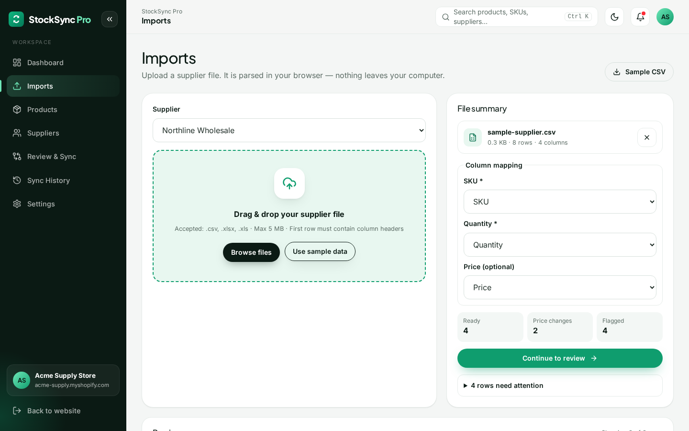
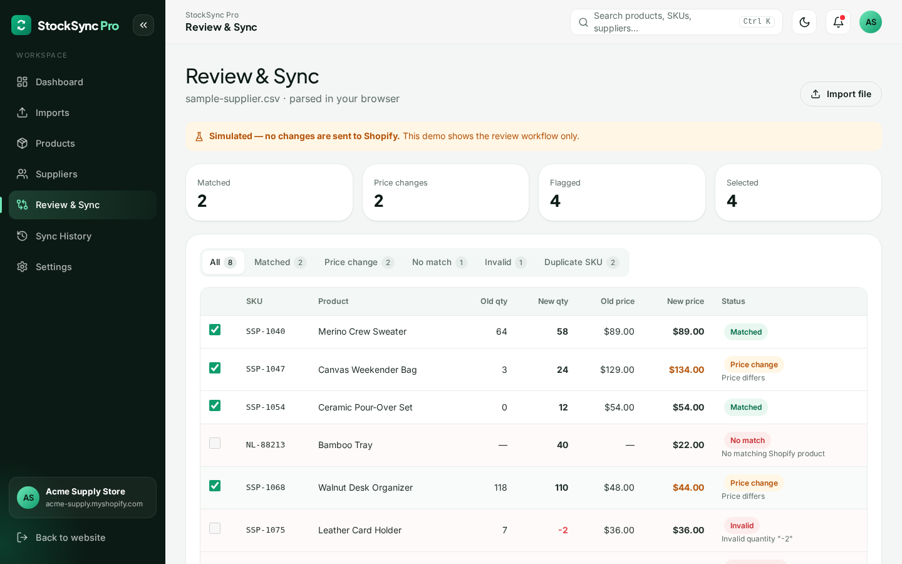

# StockSync Pro

An early-access **demo** of a SaaS tool that turns supplier spreadsheets into reviewable Shopify inventory updates.
Marketing site + app dashboard built with **React 18, Vite 5, JavaScript and Tailwind CSS v4**.

> **Status:** front-end demo. Files are parsed in your browser and compared with a sample catalog.
> **No data is sent to Shopify** and no accounts are created.



## What works now vs. simulated vs. planned

| Area | Status |
| --- | --- |
| CSV import (`.csv`) | ✅ Works — parsed in the browser with PapaParse |
| Excel import (`.xlsx`, `.xls`) | ✅ Works — first worksheet parsed with SheetJS |
| File checks | ✅ Type check, 5 MB limit, empty-file and header checks |
| Column detection + manual mapping | ✅ Works — SKU / Quantity / Price dropdowns, prefilled when detected |
| SKU matching & validation | ✅ Works — see rules below |
| Review table (old → new qty/price, flags) | ✅ Works against a **sample catalog** |
| Sync to Shopify | 🧪 **Simulated** — "Run Demo Sync" changes nothing |
| Dashboard stats, sync history, suppliers, team | 🧪 Sample data |
| Login / Sign up | 🧪 Demo access only — no account is created, nothing is verified or stored |
| Contact form | 🧪 Client-side validation only, nothing is sent |
| Live Shopify connection (Admin API) | 🗓 Planned |
| Scheduled sync, email alerts, automated summaries | 🗓 Planned |
| Saved mappings / multi-store / roles persisted on a server | 🗓 Planned |

### Validation rules (`src/utils/sku.js`)
- SKUs are trimmed and compared case-insensitively (`sku-123` = `SKU-123`).
- Quantity must be a whole number ≥ 0. Blank, text, negative (`-2`) or decimal (`12.5`) → **Invalid** (never treated as 0).
- Blank price = *not provided* (quantity-only update), never `0`. Non-numeric price → Invalid.
- If a SKU appears more than once, **every** row with that SKU is flagged **Duplicate**.
- Rows without a SKU are Invalid and are never applied. SKUs not in the catalog are flagged **No match**.
- Only *Matched* and *Price change* rows can be selected. Matching uses `Map` lookups — O(n + m).

## Setup

```bash
npm install
npm run dev       # http://localhost:5173
npm test          # unit tests (Vitest)
npm run build     # production build in dist/
npm run preview
```

Requires Node 18+. SheetJS is installed from the official CDN tarball (`https://cdn.sheetjs.com`), not the outdated npm registry package.

## Sample file format

A ready-made file is at [`public/sample-supplier.csv`](public/sample-supplier.csv) (also downloadable from the Imports page).

```csv
SKU,Product,Quantity,Price
SSP-1040,Merino Crew Sweater,58,89.00
SSP-1047,Canvas Weekender Bag,24,134.00
```

Header names can differ (e.g. `Item Code`, `On Hand`, `Unit Cost`) — they are auto-detected, and you can map them manually.
The first row must contain headers. Max file size 5 MB.

## Screenshots

| Dashboard | Imports | Review |
| --- | --- | --- |
|  |  |  |

Mobile: [home](docs/screenshots/home-mobile.png) · [dashboard](docs/screenshots/dashboard-mobile.png)

## Project structure

```
src/
  data/        page copy, SEO titles/descriptions, sample data
  components/  layout, navbar (mega menu), sections, ui/button
  pages/       marketing routes (each content section is its own page)
  app/         dashboard: Imports, Review & Sync, Products, Suppliers, History, Settings, Ctrl+K palette
  hooks/       useCsvImport, useTable, useSeo
  utils/       sku.js (matching/validation), parseFile.js (CSV/Excel), csv export, cn()
  styles/      index.css (Tailwind + tokens), ui.js (Tailwind class recipes + cx())
public/        favicon, og-image.png, robots.txt, sitemap.xml, sample-supplier.csv
```

## SEO

Each route sets a unique `<title>`, meta description and Open Graph tags (`src/hooks/useSeo.js`, `src/data/seo.js`).
`robots.txt`, `sitemap.xml` and the `og:image` URL use the **placeholder domain `stocksync-pro.example.com`** — replace it before deploying.

## Known limitations

- Single-page app: titles/descriptions are set client-side; crawlers that don't run JavaScript only see the defaults in `index.html`.
- Only the first Excel worksheet is read. Very large files are parsed on the main thread.
- Mappings, selections and dashboard data are not persisted (review data lives in `sessionStorage`).
- The product catalog used for matching is sample data.

## Roadmap

1. Shopify app with OAuth and Admin API inventory/price updates
2. Server-side persistence for suppliers, mappings and sync history
3. Scheduled imports (URL/FTP/Google Sheets) and email alerts
4. Multi-store support and team roles for agencies

## Security

Never commit secrets (Shopify API keys, access tokens, `.env` files). Keep them in environment variables
that are listed in `.gitignore`. This demo needs no secrets.
